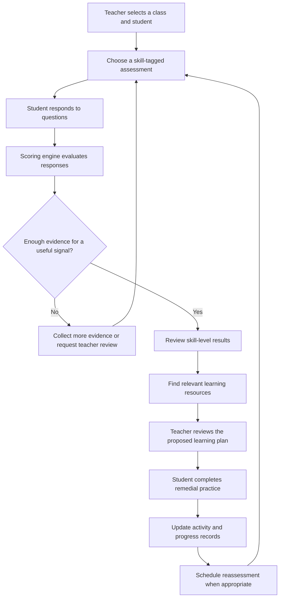
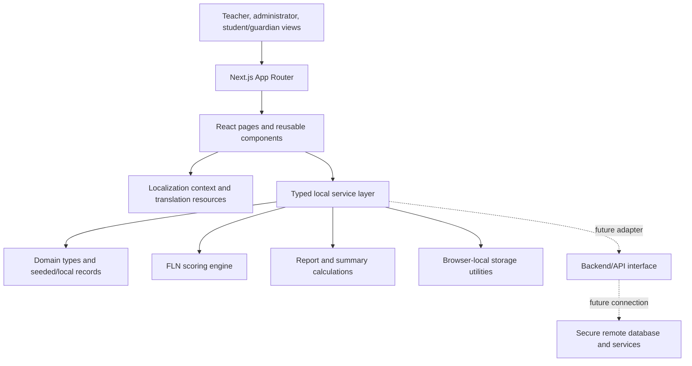
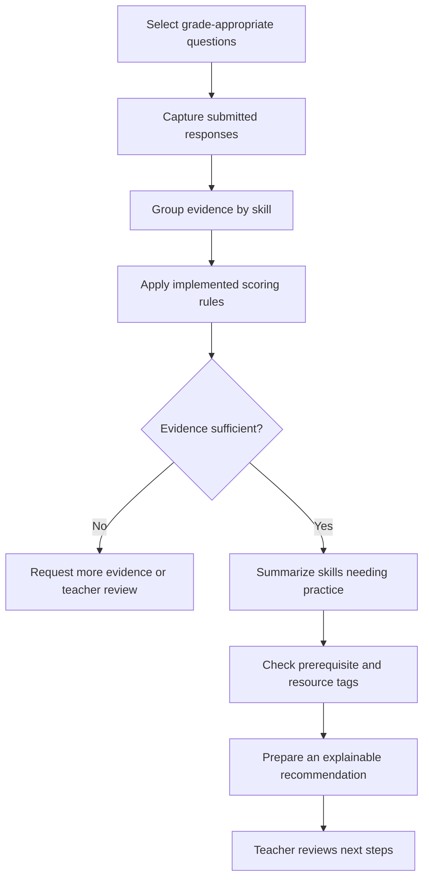
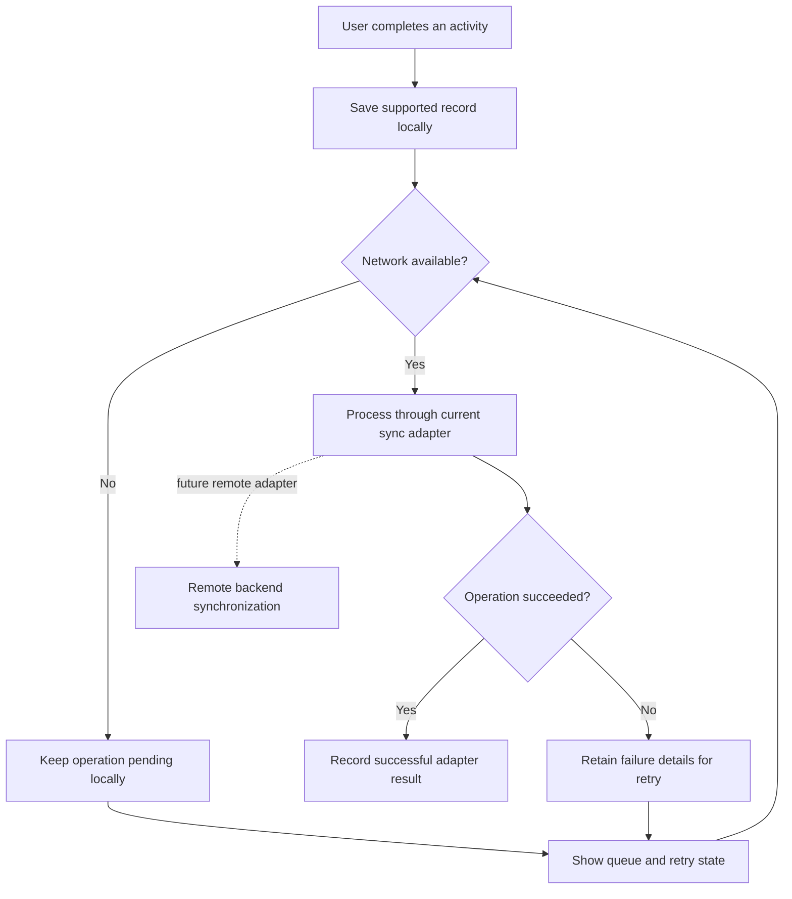

<div align="center">

# Saksham FLN

### Every child deserves a pathway forward.

**An offline-conscious, multilingual learning-support frontend for foundational literacy and numeracy.**

[](https://nextjs.org/)
[](https://react.dev/)
[](https://www.typescriptlang.org/)
[](https://tailwindcss.com/)
[](LICENSE)

**Problem ID:** PS000034 · **Sector:** Education Technology  
**Problem context:** Collector Office — Devbhumi Dwarka, Gujarat, India  
**Learning levels:** Standards 1–8

</div>

---

## Overview

Saksham FLN is a proposed learning-support platform for primary and upper-primary schools. It helps teachers organize foundational literacy and numeracy (FLN) assessments, inspect skill-level evidence, plan targeted remedial activities, and follow student progress over time. 

In classrooms where teachers support students with different levels of comprehension, a total score alone may not show which prerequisite concept needs attention. Saksham FLN is designed around a practical cycle: **assess a skill → understand the evidence → choose a suitable activity → review progress → reassess when appropriate**.

The repository currently contains a **frontend-focused prototype** with Next.js pages, reusable interface components, a local data/service layer, multilingual resources, and an explainable scoring engine. It is not presented as a live government deployment or a production-ready student information system. See [Current scope and limitations](#current-scope-and-limitations).

## The problem

Teachers may have limited time to provide individual support while students can experience different foundational learning challenges, including:

- Letter recognition, letter-sound association, decoding, and reading comprehension.
- Number sense, place value, quantity comparison, addition, and subtraction.
- Gaps in prerequisite concepts that are difficult to identify from overall marks alone.
- Inconsistent records of remedial activities, follow-up actions, and learning milestones.
- Unreliable connectivity in some school environments.
- The risk of stigmatizing students through fixed labels or public rankings.

Saksham FLN is designed to support teacher judgment with structured evidence and practical next steps. Its intended role is educational support—not medical diagnosis, permanent student labeling, or a replacement for educators.

## How it works

The primary product workflow is shown below. The implementation should be checked against the current code before treating every step as production-ready.



A short assessment provides a **screening signal**, not a validated diagnosis. Recommendations should remain explainable and reviewable by a teacher, especially when assessment evidence is limited.

## Key product areas

The repository includes routes and components for the following workflows. Actual behavior may vary by module; use the source code and the verification report, if available, to confirm the completeness of any individual workflow.

### 1. School and academic administration

- School profile and administrative details.
- Academic-year management.
- Staff directory and role selection/simulation.
- Class and section configuration for Standards 1–8.
- Class-teacher assignments and school context.

### 2. Class-wise management

- Class directory and class detail workspace.
- Student roster and class-level overview.
- Assessment and learning-plan views.
- Teacher actions and class-level reporting.
- Class filters and supported CSV export workflows.

### 3. Student profiles

- Student directory and individual profile pages.
- Literacy and numeracy skill indicators.
- Assessment history and supporting evidence.
- Learning-plan and activity history.
- Formative teacher observations and suggested next actions.

The interface is intended to use skill-specific, non-stigmatizing language. It should not publicly rank children or describe a student as inherently weak or incapable.

### 4. Question bank and assessments

- Question bank with grade, subject, skill, difficulty, language, and review-related metadata.
- Assessment creation and assignment flows.
- Assessment status views, including draft, scheduled, in-progress, completed, and review states where implemented.
- Child-oriented question presentation.
- A scoring engine designed to produce evidence by skill rather than relying only on a single overall score.
- Audio read-aloud through browser speech capabilities where supported by the browser and the implementation.

### 5. Diagnostic scoring and learning recommendations

The custom scoring implementation lives in [`lib/fln-scoring-engine.ts`](lib/fln-scoring-engine.ts). It should be read alongside the question/assessment types and related services to understand the current rules.

The intended approach is to associate questions with skills and prerequisite concepts, evaluate submitted responses, and use those results to inform practice recommendations. The current repository should not be described as using a trained machine-learning model or external LLM unless such integration is added and verified.

### 6. Learning resources and content management

The product includes resource and content-management areas for learning materials such as:

- Visual flashcards.
- Phonics and reading activities.
- Number-line and arithmetic practice.
- Short instructional content.
- Printable worksheets where a resource is provided.
- Draft, review, and publication-related content states where implemented.

A curriculum reference should only be called GCERT-verified after the relevant material has actually been checked against a trustworthy curriculum source.

### 7. Adaptive learning plans

- Student- or class-associated learning plans.
- Short, scheduled remedial activities.
- Teacher review and approval flows where implemented.
- Activity completion tracking.
- Follow-up and reassessment planning.

Plans are meant to remain editable by teachers. A suggested activity is not a substitute for teacher judgment.

### 8. Teacher action workspace

- Prioritized teaching and follow-up actions.
- Due dates and status tracking.
- Links to relevant students, classes, skills, or assessments where supported.
- Notes and intervention history.

### 9. Reports and administrative oversight

The codebase contains report routes for class, skill, and assessment views, alongside a district overview. These views are intended to help authorized staff monitor assessment coverage, learning-support needs, and intervention progress.

Reports should use consistent underlying records. Sample or seeded figures must not be presented as real district results or measured learning gains.

### 10. Parent and guardian support

Guardian-related routes support a limited, family-oriented view of relevant learning progress and home-practice suggestions. Any real messaging integration must be separately connected and verified; a notification preview is not proof that a message was sent.

### 11. English, Gujarati, and Hindi interface

The application includes a localization context and translation resources for:

- English (`en`)
- Gujarati (`gu`)
- Hindi (`hi`)

The intended font configuration uses Inter for English, Noto Sans Gujarati for Gujarati, and Noto Sans Devanagari for Hindi, subject to the assets and CSS actually loaded by the running application. Language completeness and font rendering should be tested across all routes, not just the language selector.

### 12. Local persistence, offline interface, and audit history

The repository contains local storage utilities and services for several record types, along with an offline/synchronization interface and audit-history pages. These features are useful for prototyping local workflows and designing a future offline-first experience.

**Important:** browser-local persistence is not the same as reliable synchronization with a remote database. Any simulated sync must be described as simulated until an actual remote adapter exists and has been tested.

## Current architecture

The architecture below reflects the frontend-oriented structure in the repository. Dashed connections represent future integration opportunities, not currently connected production services.



### Repository structure

```text
app/
  page.tsx                    # Product landing page
  login/                      # Login/role-entry interface
  app/                        # Main application workspace and modules
  district/                   # District-level overview
  guardian/                   # Guardian progress view
components/                   # Shared layouts, dialogs, and UI components
lib/
  types/                      # Shared TypeScript domain types
  services/                   # Local data services and workflow logic
  storage/                    # Browser-local persistence helpers
  i18n/                       # Locale context and translation resources
  fln-scoring-engine.ts       # Explainable FLN assessment logic
  demo-data.ts                # Seeded/sample application data
docs/
  product-spec.md             # Product specification
  implementation-plan.md      # Intended implementation and phase plan
public/                       # Icons and static assets
```

## Technology stack

The following stack is based on the repository's package manifest and source imports. Recheck it if dependencies change.

| Technology | Purpose in this project |
|---|---|
| **Next.js App Router** | Page routing, layouts, and application structure. |
| **React 19** | Component-based user interface and interactive workflows. |
| **TypeScript** | Typed domain models and application code. |
| **Tailwind CSS v4** | Utility-based styling and responsive layout. |
| **Base UI / shadcn-style components** | Accessible UI primitives and reusable controls where used. |
| **Lucide React** | Consistent interface icons. |
| **Browser localStorage** | Current local persistence for selected application records and preferences. |
| **Custom FLN scoring engine** | Deterministic skill-level scoring/recommendation logic implemented in the repository. |
| **Localization context and dictionaries** | English, Gujarati, and Hindi UI resources. |
| **Vercel Analytics package** | Analytics integration is configured in the root layout for production builds; verify deployment configuration before assuming data is being collected. |
| **pnpm** | Package manager declared in the project manifest. |

No database, authentication provider, remote file storage, or external AI model should be assumed to be connected unless the codebase and runtime configuration demonstrate otherwise.

## Getting started

### Prerequisites

- Node.js compatible with the installed Next.js version.
- pnpm, matching the package manager declared in `package.json`.
- Git.

### 1. Clone the repository

```bash
git clone https://github.com/shreyanshio/sypnosis.git
cd sypnosis
```

### 2. Install dependencies

```bash
pnpm install
```

### 3. Start the development server

```bash
pnpm dev
```

Open the local URL printed by Next.js in the terminal (usually `http://localhost:3000`).

### 4. Create a production build

```bash
pnpm build
pnpm start
```

The project currently defines `dev`, `build`, and `start` scripts in `package.json`. No environment variables are required for the documented local frontend flow unless the code has been changed to introduce an external integration.

### Type-checking note

For an independent TypeScript check, run:

```bash
pnpm exec tsc --noEmit
```

The current `next.config.mjs` configures Next.js to ignore TypeScript build errors. Therefore, a successful `pnpm build` alone must not be treated as proof that a strict TypeScript check passed. Run and review the separate type check as part of verification.

## Important routes

| Route | Purpose |
|---|---|
| `/` | Product landing page |
| `/login` | Login and role-entry interface |
| `/app/dashboard` | Main workspace overview |
| `/app/classes` | Class directory |
| `/app/classes/[classId]` | Class workspace |
| `/app/students` | Student directory |
| `/app/students/[studentId]` | Student profile |
| `/app/question-bank` | Question bank |
| `/app/assessments` | Assessment directory |
| `/app/assessments/new` | Assessment creation |
| `/app/assessments/[assessmentId]` | Assessment detail/session route |
| `/app/resources` | Learning resource library |
| `/app/content-management` | Learning-content workflow |
| `/app/pathways` | Adaptive pathway views |
| `/app/learning-plans` | Learning plan directory |
| `/app/reassessments` | Reassessment scheduling |
| `/app/actions` | Teacher action workspace |
| `/app/reports` | Reporting overview |
| `/app/reports/classes` | Class reports |
| `/app/reports/skills` | Skill reports |
| `/app/reports/assessments` | Assessment reports |
| `/app/admin/school` | School profile management |
| `/app/admin/academic-years` | Academic-year management |
| `/app/admin/users` | Staff/user management interface |
| `/app/admin/classes` | Administrative class setup |
| `/app/guardians` | Guardian-related workspace |
| `/guardian/progress/[studentId]` | Guardian progress view |
| `/app/audit-history` | Audit-history interface |
| `/district/overview` | District overview |

Routes are listed from the current repository structure. A route existing in the code does not, by itself, prove every interaction on that page is complete.

## Diagnostic decision flow



This diagram describes the intended educational workflow. The current behavior and decision thresholds must be verified against `lib/fln-scoring-engine.ts`; screening results should not be represented as a validated educational or medical diagnosis.

## Offline and synchronization concept



The diagram intentionally distinguishes browser-local operations from future server synchronization. Do not rely on the interface's sync status as evidence that a remote backend has received data unless that backend integration has been implemented and tested.

## Current scope and limitations

Saksham FLN is being developed as a frontend-oriented prototype. Before using it with real children or school records, the following items require implementation, integration, or explicit validation as applicable:

- **Authentication and authorization:** client-side role selection is not production authentication. Production role enforcement must happen on a trusted backend.
- **Database and storage:** browser-local persistence is suitable for prototyping but is not a shared, centrally managed school database.
- **Remote synchronization:** an offline UI or simulated queue does not prove that data is synchronized to a server.
- **AI integration:** the local scoring engine should be described according to its actual rules; do not assume an external AI model is connected.
- **Curriculum validation:** GCERT mapping and resource verification require review against the appropriate source material.
- **Educational validation:** diagnostic rules and thresholds need evaluation with educators and appropriate evidence before classroom deployment.
- **Child data protection:** use fictional seed records during development. Do not enter real student personal information into an unsecured prototype.
- **External communication:** SMS, WhatsApp, and email delivery require separate, verified integrations and appropriate consent processes.
- **Testing and accessibility:** run type checks and workflow tests; conduct browser, responsive, accessibility, and usability reviews before deployment.

These limitations are part of an honest development status, not claims that the intended production architecture is already complete.

## Evaluation and expected impact

Saksham FLN aims to make remedial teaching more targeted and progress tracking more systematic. Its effectiveness should be assessed through measurable indicators rather than assumed outcomes.

Suggested evaluation measures:

- Time needed to complete an assessment.
- Agreement between initial skill signals and teacher-reviewed evidence.
- Completion of assigned remedial activities.
- Change across comparable reassessments.
- Reliability of local data persistence and any implemented synchronization.
- Teacher usability feedback.
- Quality and completeness of Gujarati, Hindi, and English experiences.
- Accessibility and usability across common school devices.

No learning gains, dropout reduction, diagnostic accuracy, pilot adoption, or time savings are claimed here as measured results.

## Roadmap

1. **Validate assessment content:** review skill tags, item quality, scoring rules, and prerequisite relationships with educators.
2. **Verify curriculum mapping:** connect resources to correctly cited GCERT learning outcomes and review materials before publication.
3. **Strengthen testing:** add automated tests for assessment scoring, class/student relationships, persistence, localization, reports, and complete user journeys.
4. **Connect secure services:** implement real authentication, role-based access enforcement, and a shared backend database.
5. **Harden offline behavior:** define conflict handling, retry rules, and tested remote synchronization.
6. **Evaluate with educators:** conduct usability studies and a carefully approved pilot before making outcome claims.
7. **Consider Android delivery:** determine whether an installable PWA is sufficient or a dedicated Android app is required by the intended deployment.

## Repository documentation

- [Product specification](docs/product-spec.md)
- [Implementation plan](docs/implementation-plan.md)
- [FLN scoring engine](lib/fln-scoring-engine.ts)
- [Domain types](lib/types/index.ts)
- [Local storage utilities](lib/storage/index.ts)
- [Service layer](lib/services/)
- [Localization context](lib/i18n/context.tsx)
- [Translation resources](lib/i18n/translations.ts)
- [Seed/sample data](lib/demo-data.ts)

## Contributing

Contributions that improve usability, assessment explainability, accessibility, language quality, data consistency, testing, or maintainability are welcome.

1. Fork the repository and create a focused branch.
2. Make a small, reviewable change consistent with the existing architecture.
3. Avoid adding real student or guardian data to code, screenshots, test fixtures, or commits.
4. Run the available type checks and relevant workflows.
5. Open a pull request explaining the problem, change, and verification performed.

For educational content, include the skill, grade range, language, source/reference where known, and appropriate review status. Do not mark content curriculum-verified without checking the relevant source.

## License

This project is licensed under the MIT License. See [`LICENSE`](LICENSE) for the full text. Third-party dependencies, fonts, educational content, and other externally sourced assets remain subject to their respective license and attribution requirements.

---

<div align="center">

**Saksham FLN** · Foundational Learning Support · Problem PS000034

</div>

## Development History & Milestones

- **2025-01-26** [H]: Foundational literacy & numeracy roadmap spec.
- **2025-01-27** [H]: Foundational literacy & numeracy roadmap spec.
- **2025-01-28** [H]: Foundational literacy & numeracy roadmap spec.
- **2025-01-29** [H]: Foundational literacy & numeracy roadmap spec.
- **2025-01-30** [H]: Foundational literacy & numeracy roadmap spec.
- **2025-01-31** [H]: Foundational literacy & numeracy roadmap spec.
- **2025-02-01** [H]: Foundational literacy & numeracy roadmap spec.
- **2025-02-05** [H]: Foundational literacy & numeracy roadmap spec.
- **2025-02-12** [H]: Foundational literacy & numeracy roadmap spec.
- **2025-02-19** [H]: Foundational literacy & numeracy roadmap spec.
- **2025-02-23** [H]: Foundational literacy & numeracy roadmap spec.
- **2025-02-24** [H]: Foundational literacy & numeracy roadmap spec.
- **2025-02-25** [H]: Foundational literacy & numeracy roadmap spec.
- **2025-02-26** [H]: Foundational literacy & numeracy roadmap spec.
- **2025-02-27** [H]: Foundational literacy & numeracy roadmap spec.
- **2025-02-28** [H]: Foundational literacy & numeracy roadmap spec.
- **2025-03-01** [H]: Foundational literacy & numeracy roadmap spec.
- **2025-04-06** [E]: Foundational literacy & numeracy roadmap spec.
- **2025-04-07** [E]: Foundational literacy & numeracy roadmap spec.
- **2025-04-08** [E]: Foundational literacy & numeracy roadmap spec.
- **2025-04-09** [E]: Foundational literacy & numeracy roadmap spec.
- **2025-04-10** [E]: Foundational literacy & numeracy roadmap spec.
- **2025-04-11** [E]: Foundational literacy & numeracy roadmap spec.
- **2025-04-12** [E]: Foundational literacy & numeracy roadmap spec.
- **2025-04-13** [E]: Foundational literacy & numeracy roadmap spec.
- **2025-04-16** [E]: Foundational literacy & numeracy roadmap spec.
- **2025-04-19** [E]: Foundational literacy & numeracy roadmap spec.
- **2025-04-20** [E]: Foundational literacy & numeracy roadmap spec.
- **2025-04-23** [E]: Foundational literacy & numeracy roadmap spec.
- **2025-04-26** [E]: Foundational literacy & numeracy roadmap spec.
- **2025-04-27** [E]: Foundational literacy & numeracy roadmap spec.
- **2025-04-30** [E]: Foundational literacy & numeracy roadmap spec.
- **2025-05-03** [E]: Foundational literacy & numeracy roadmap spec.
- **2025-05-04** [E]: Foundational literacy & numeracy roadmap spec.
- **2025-05-10** [E]: Foundational literacy & numeracy roadmap spec.
- **2025-06-15** [L1]: Foundational literacy & numeracy roadmap spec.
- **2025-06-16** [L1]: Foundational literacy & numeracy roadmap spec.
- **2025-06-17** [L1]: Foundational literacy & numeracy roadmap spec.
- **2025-06-18** [L1]: Foundational literacy & numeracy roadmap spec.
- **2025-06-19** [L1]: Foundational literacy & numeracy roadmap spec.
- **2025-06-20** [L1]: Foundational literacy & numeracy roadmap spec.
- **2025-06-21** [L1]: Foundational literacy & numeracy roadmap spec.
- **2025-06-28** [L1]: Foundational literacy & numeracy roadmap spec.
- **2025-07-05** [L1]: Foundational literacy & numeracy roadmap spec.
- **2025-07-12** [L1]: Foundational literacy & numeracy roadmap spec.
- **2025-07-19** [L1]: Foundational literacy & numeracy roadmap spec.
- **2025-08-24** [L2]: Foundational literacy & numeracy roadmap spec.
- **2025-08-25** [L2]: Foundational literacy & numeracy roadmap spec.
- **2025-08-26** [L2]: Foundational literacy & numeracy roadmap spec.
- **2025-08-27** [L2]: Foundational literacy & numeracy roadmap spec.
- **2025-08-28** [L2]: Foundational literacy & numeracy roadmap spec.
- **2025-08-29** [L2]: Foundational literacy & numeracy roadmap spec.
- **2025-08-30** [L2]: Foundational literacy & numeracy roadmap spec.
- **2025-09-06** [L2]: Foundational literacy & numeracy roadmap spec.
- **2025-09-13** [L2]: Foundational literacy & numeracy roadmap spec.
- **2025-09-20** [L2]: Foundational literacy & numeracy roadmap spec.
- **2025-09-27** [L2]: Foundational literacy & numeracy roadmap spec.
- **2025-11-03** [O]: Foundational literacy & numeracy roadmap spec.
- **2025-11-04** [O]: Foundational literacy & numeracy roadmap spec.
- **2025-11-05** [O]: Foundational literacy & numeracy roadmap spec.
- **2025-11-06** [O]: Foundational literacy & numeracy roadmap spec.
- **2025-11-07** [O]: Foundational literacy & numeracy roadmap spec.
- **2025-11-09** [O]: Foundational literacy & numeracy roadmap spec.
- **2025-11-15** [O]: Foundational literacy & numeracy roadmap spec.
